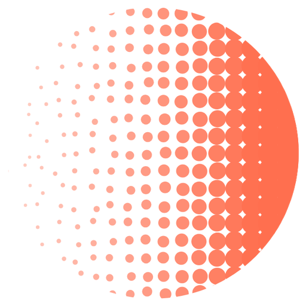

[English](README.md) | **한국어**

<h1 align="center"> Kroma</h1>

Kroma는 Snapdragon 폰의 NPU로 이미지 생성 모델을 돌리는 안드로이드 앱입니다. 이미지 모델들을 fp16 가중치 그대로 돌릴 수 있습니다. 프롬프트와 생성한 이미지는 외부로 전송되지 않습니다.

0.9.0은 베타입니다. 확인한 기기가 많지 않으니 문제가 생기면 알려 주세요.

[**APK 다운로드**](../../releases/latest) · [**텔레그램**](https://t.me/+hIkBf_hlX280NjM1) · [**작동 방식**](docs/HOW_IT_WORKS.md) · [**문제 신고**](../../issues)

*Kroma로 만든 그림이며 모두 AI로 생성했습니다. Krea 2 Turbo 위주이며, Anima Turbo, FLUX.2 Klein 그림이 섞여 있습니다. 결과는 프롬프트와 설정에 따라 달라집니다.*

## 특징

* 기본 모델은 fp16 원본입니다. Q8·Q4는 저장 공간을 아끼고 싶을 때 고르면 됩니다.
* .safetensors 파인튠을 넣거나 온라인에서 찾아 받으면 폰에서 바로 변환합니다. LoRA는 파일로 넣거나 Civitai 브라우저에서 가져올 수 있으며, 최대 4096랭크(SDXL은 512랭크), 런타임 방식으로 지원됩니다.
* 모델을 받은 뒤에는 인터넷 없이 쓸 수 있습니다. 가입할 계정이나 거쳐 가는 서버도 없습니다.
* txt2img, img2img, 인페인팅, 아웃페인팅, ×2 업스케일을 지원합니다. FLUX.2 Klein으로는 참조 이미지를 최대 3장까지 넣어 편집할 수 있습니다.
* 한국어·일본어·중국어·러시아어로 쓴 프롬프트는 폰 안에서 영어로 번역할 수 있습니다. 앱은 영어, 한국어, 중국어 간체·번체, 일본어, 러시아어, 스페인어, 포르투갈어를 지원합니다.

## 모델

모델은 앱 안에서 골라 받을 수 있으며, 받기 전에 용량을 보여 줍니다.

|모델|주 용도|라이선스|
|---|---|---|
|Krea 2 Turbo|실사, 일반 일러스트|Krea 2 Community License|
|Anima Turbo|애니메이션 일러스트|비상업용|
|SDXL Base 1.0|여러 파인튠의 베이스|CreativeML Open RAIL++-M|
|FLUX.2 Klein 4B Turbo|참조 이미지 편집|Apache 2.0|
|FLUX.2 Klein 9B|더 정확한 참조 이미지 편집|FLUX Non-Commercial License|
|MOSS-Image Turbo|실사, 애니메이션 일러스트|Apache 2.0|
|YuE2|가사가 있는 곡|비상업용|

## 지원 기기

RAM 12GB 이상인 Snapdragon 폰을 권장하며, RAM 8GB 기기에선 테스트되지 않았습니다. 이미지 모델은 Kroma의 자체 NPU 엔진인 [Kengine](https://github.com/Pixfanthav/Kengine)으로 돌며, 칩 제조사의 AI 런타임이나 SDK를 쓰지 않습니다.

Snapdragon 8s Gen 3·8s Gen 4·7+ Gen 3 폰은 Anima만 시험 지원하며, 아직 실기기에서 확인하지 못했습니다. 써 보신 분은 이미지 생성 여부에 관계없이 설정 → 로그 보내기로 로그를 공유해 주세요.

|칩|해당 폰|Anima 10스텝|SDXL 25스텝|Klein 4B 4스텝|Klein 9B 4스텝|MOSS 8스텝|Krea 2 8스텝|
|---|---|---|---|---|---|---|---|
|Snapdragon 8 Elite Gen 5|Galaxy S26 Ultra 등|24초|1분 27초|20초| |46초|1분 46초|
|Snapdragon 8 Elite|Galaxy S25 시리즈 등|31초|1분 42초| | | | |
|Snapdragon 8 Gen 3|Galaxy S24 Ultra 등| | | |1분 (Q8)| | |
|Snapdragon 8 Gen 2|Galaxy S23 시리즈 등|41초|2분 25초|39초|1분 19초|1분 43초|3분 39초|

1024×1024 기준입니다. 폰이 충분히 식은 상태에서 쟀으며, 발열이 있으면 더 느려집니다. 빈칸은 미측정 항목입니다.

YuE2는 곡이 길수록 시간이 크게 늘어납니다. Snapdragon 8 Gen 2(Galaxy S23 Ultra) 기준:

|곡 길이|생성 시간|
|---|---|
|1분|6분 35초|
|2분 7초 (연주곡)|17분 51초|
|2분 25초|22분 58초|
|2분 57초|38분 48초|

## 시작하기

1. [APK](../../releases/latest)를 받아 설치합니다.
1. 앱을 열고 언어를 고른 뒤 모델 라이선스에 동의합니다.
1. 받을 모델을 고릅니다. 모델마다 수 GB에서 수십 GB이기에 Wi-Fi에 연결하고 충전기를 꽂아 두는 편이 좋습니다.
1. 프롬프트를 입력하고 생성 버튼을 누릅니다.

## 콘텐츠 필터

모델 라이선스 조건에 따라 콘텐츠 필터를 넣었습니다. 성인 사용자는 설정에서 흐림 처리를 끌 수 있습니다.

## 문제가 생기면

* 설정 → 로그 보내기를 누르면 기기 정보와 시간 기록이 담긴 파일이 만들어집니다. 프롬프트는 들어가지 않습니다. 이 파일을 [Issues](../../issues)나 [텔레그램](https://t.me/+hIkBf_hlX280NjM1)에 올려 주세요.
* 그림이 깨져 나오면(잡음, 한 가지 색, 검은 화면) 설정 → 진단 로그를 켜고 같은 그림을 한 번 더 생성한 뒤 로그 보내기를 해 주세요. 모델의 어느 부분에서 문제가 생겼는지 로그에 남습니다.
* 생성하는 동안에는 화면을 켜 두세요. 앱이 알아서 화면을 켜 두긴 하지만, 폰을 잠그면 앱이 느린 코어로 넘어가 속도가 떨어집니다.
* 폰이 뜨겁거나 배터리가 20% 아래로 내려가면 느려집니다.

## 크레딧

Kroma는 아래 모델과 도구를 바탕으로 만들었습니다. 라이선스 전문을 포함한 전체 목록은 `app/src/main/assets/NOTICE.txt`에서 볼 수 있습니다.

* [Krea 2 Turbo](https://krea.ai/krea-2-licensing), Krea.ai
* [Anima](https://huggingface.co/circlestone-labs/Anima), CircleStone Labs (NVIDIA Cosmos 기반)
* [SDXL 1.0](https://huggingface.co/stabilityai/stable-diffusion-xl-base-1.0), Stability AI / fp16 VAE 수정: Ollin Boer Bohan
* [FLUX.2 Klein](https://huggingface.co/black-forest-labs), Black Forest Labs
* [MOSS-Image](https://huggingface.co/OpenMOSS-Team), OpenMOSS Team / [HaDeS MOSS Turbo](https://github.com/Devildonia/HaDeS-MOSS-Suite), HaDeS
* [YuE2](https://huggingface.co/m-a-p), M-A-P
* 텍스트 인코더·VAE: Alibaba Cloud Qwen 계열
* [PLaMo 3 Translate](https://huggingface.co/pfnet/plamo-3-translate-0.8b-GGUF), Preferred Networks (Built with PLaMo) / [EmbeddingGemma 2](https://huggingface.co/onnx-community/embeddinggemma-2-ONNX), Google
* [Real-ESRGAN](https://github.com/xinntao/Real-ESRGAN), Xintao Wang / [nsfw_image_detection](https://huggingface.co/Falconsai/nsfw_image_detection), Falconsai
* [llama.cpp / ggml](https://github.com/ggml-org/llama.cpp), [yue2.cpp](https://github.com/ServeurpersoCom/yue2.cpp), [ONNX Runtime](https://github.com/microsoft/onnxruntime)

## 빌드

[docs/BUILDING.md](docs/BUILDING.md)를 보세요. NPU 엔진은 다른 저장소인 [Kengine](https://github.com/Pixfanthav/Kengine)에서 개발합니다.

## 라이선스

앱은 GPL-3.0 라이선스를 따릅니다(`LICENSE`, `LICENSE.NOTE.md`). 모델은 저마다 라이선스가 따로 있으며, 전문은 위 목록과 `app/src/main/assets/NOTICE.txt`에 있습니다. Anima, FLUX.2 Klein 9B, YuE2는 비상업 용도로만 쓸 수 있습니다. Kroma는 독립 프로젝트로, 위 모델의 제작사가 만들거나 보증한 앱이 아닙니다.

Snapdragon은 Qualcomm Incorporated의 상표입니다. Kroma는 Qualcomm과 제휴 관계가 없으며 Qualcomm의 보증을 받지 않았습니다.

개발 과정에 Claude(Anthropic)가 사용되었습니다.
