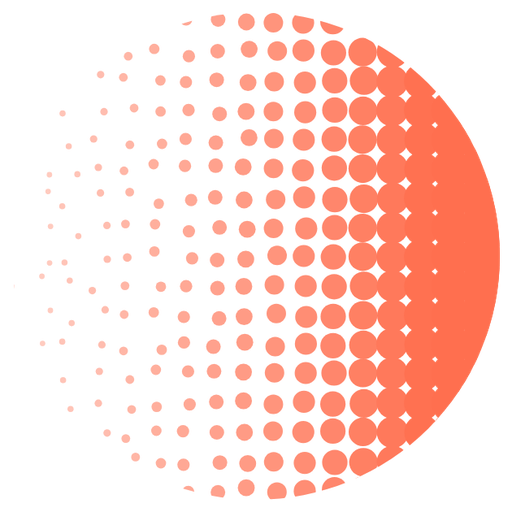
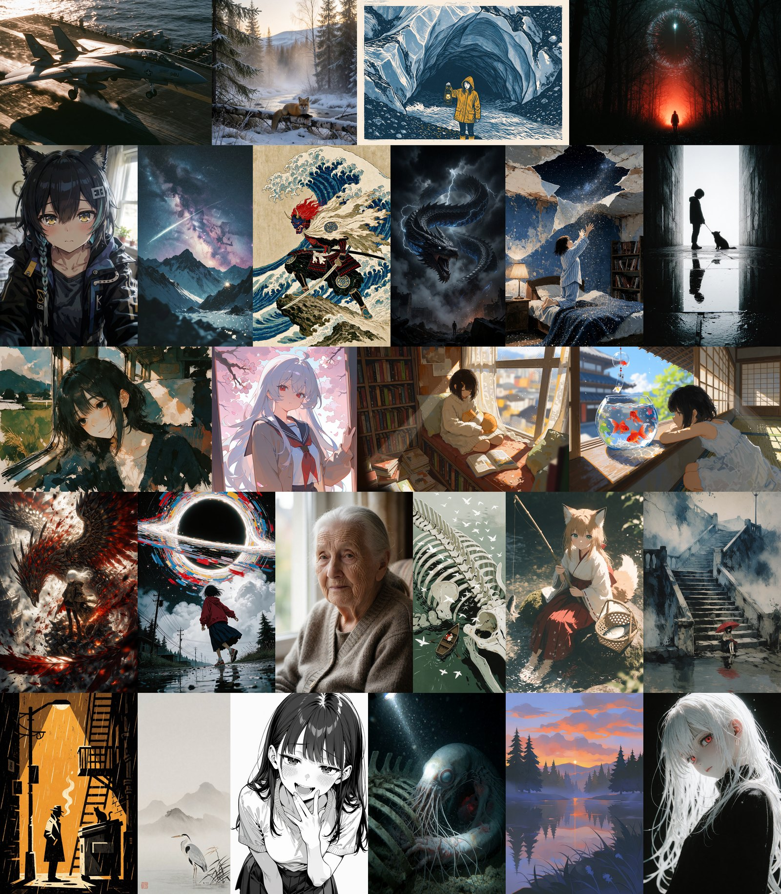

**English** | [한국어](README.ko.md)

<h1 align="center"> Kroma</h1>

Kroma is an Android app that runs image generation models on the NPU of Snapdragon phones. It can run the image models with their fp16 weights as they are. Prompts and generated images are never sent outside the phone.

0.9.0 is a beta: it has been checked on only a few phones, so please report what goes wrong.

**[Download the APK](../../releases/latest)** · **[Telegram group](https://t.me/+hIkBf_hlX280NjM1)** · **[How it works](docs/HOW_IT_WORKS.md)** · **[Report a problem](../../issues)**

*Pictures made with Kroma, all generated by AI. Mostly Krea 2 Turbo, with some Anima Turbo and FLUX.2 Klein pictures mixed in. Results vary with the prompt and the settings.*

## Features

* The default models are the original fp16 weights. Q8 and Q4 are there for when you want to save storage.
* Bring a .safetensors fine-tune, or find one online and download it, and it is converted on the phone. LoRAs can be added from a file or taken from the Civitai browser, up to a combined rank of 4096 (512 for SDXL), and are applied at run time.
* After the models are downloaded, the app works without internet. There is no account to sign up for and no server in between.
* txt2img, img2img, inpainting, outpainting and ×2 upscale. With FLUX.2 Klein you can edit with up to 3 reference pictures.
* Prompts written in Korean, Japanese, Chinese or Russian can be translated to English on the phone. The app is available in English, Korean, Simplified and Traditional Chinese, Japanese, Russian, Spanish and Portuguese.

## Models

You choose the models to download inside the app, and it shows the size before downloading.

|Model|Good for|License|
|---|---|---|
|Krea 2 Turbo|photorealism, general illustration|Krea 2 Community License|
|Anima Turbo|anime illustration|non-commercial|
|SDXL Base 1.0|the base of many fine-tunes|CreativeML Open RAIL++-M|
|FLUX.2 Klein 4B Turbo|editing with reference pictures|Apache 2.0|
|FLUX.2 Klein 9B|more accurate editing with reference pictures|FLUX Non-Commercial License|
|MOSS-Image Turbo|photorealism, anime illustration|Apache 2.0|
|YuE2|songs with lyrics|non-commercial|

## Supported phones

A Snapdragon phone with 12 GB of RAM or more is recommended; phones with 8 GB have not been tested. The image models run on Kroma's own NPU engine, [Kengine](https://github.com/Pixfanthav/Kengine), without a chip maker's AI runtime or SDK.

Snapdragon 8s Gen 3, 8s Gen 4 and 7+ Gen 3 phones have trial support for Anima only and have not been confirmed on a real phone yet. If you try it, please share the log with Settings → Send the log, whether or not a picture was generated.

|Chip|Example phones|Anima, 10 steps|SDXL, 25 steps|Klein 4B, 4 steps|Klein 9B, 4 steps|MOSS, 8 steps|Krea 2, 8 steps|
|---|---|---|---|---|---|---|---|
|Snapdragon 8 Elite Gen 5|Galaxy S26 Ultra etc.|24 s|1 min 27 s|20 s| |46 s|1 min 46 s|
|Snapdragon 8 Elite|Galaxy S25 series etc.|31 s|1 min 42 s| | | | |
|Snapdragon 8 Gen 3|Galaxy S24 Ultra etc.| | | |1 min (Q8)| | |
|Snapdragon 8 Gen 2|Galaxy S23 series etc.|41 s|2 min 25 s|39 s|1 min 19 s|1 min 43 s|3 min 39 s|

Times are for 1024×1024, measured on a phone that had cooled down enough; heat makes it slower. Blank cells were not measured.

YuE2 takes much longer for a longer song. Times on a Snapdragon 8 Gen 2 (Galaxy S23 Ultra):

|Song length|Time|
|---|---|
|1 min|6 min 35 s|
|2 min 7 s|17 min 51 s|
|2 min 25 s|22 min 58 s|
|2 min 57 s|38 min 48 s|

## Getting started

1. Download the [APK](../../releases/latest) and install it.
2. Open the app, pick a language and agree to the model licenses.
3. Choose the models to download. Each model is several GB to tens of GB, so connect to Wi-Fi and plug in a charger.
4. Type a prompt and press Generate.

## Content filter

A content filter is included, as the model licenses require. Adults can turn off the blur in Settings.

## When something goes wrong

* Settings → Send the log creates a file with the device information and the timings. Your prompt is not in it. Post the file in [Issues](../../issues) or the [Telegram group](https://t.me/+hIkBf_hlX280NjM1).
* If pictures come out broken (noise, a single colour, black), turn on Settings → Diagnosis log, generate the same picture once more, then Send the log. The log then shows which part of the model went wrong.
* Keep the screen on while it generates. The app keeps it on by itself, but if you lock the phone the app is moved to the slow cores and gets slower.
* If the phone is hot or the battery is below 20 %, it runs slower.

## Credits

Kroma is built on these models and tools. The full list with the complete license texts is in `app/src/main/assets/NOTICE.txt`.

* [Krea 2 Turbo](https://krea.ai/krea-2-licensing), Krea.ai
* [Anima](https://huggingface.co/circlestone-labs/Anima), CircleStone Labs (built on NVIDIA Cosmos)
* [SDXL 1.0](https://huggingface.co/stabilityai/stable-diffusion-xl-base-1.0), Stability AI / fp16 VAE fix: Ollin Boer Bohan
* [FLUX.2 Klein](https://huggingface.co/black-forest-labs), Black Forest Labs
* [MOSS-Image](https://huggingface.co/OpenMOSS-Team), OpenMOSS Team / [HaDeS MOSS Turbo](https://github.com/Devildonia/HaDeS-MOSS-Suite), HaDeS
* [YuE2](https://huggingface.co/m-a-p), M-A-P
* Text encoders and VAE: Alibaba Cloud's Qwen family
* [PLaMo 3 Translate](https://huggingface.co/pfnet/plamo-3-translate-0.8b-GGUF), Preferred Networks (Built with PLaMo) / [EmbeddingGemma 2](https://huggingface.co/onnx-community/embeddinggemma-2-ONNX), Google
* [Real-ESRGAN](https://github.com/xinntao/Real-ESRGAN), Xintao Wang / [nsfw_image_detection](https://huggingface.co/Falconsai/nsfw_image_detection), Falconsai
* [llama.cpp / ggml](https://github.com/ggml-org/llama.cpp), [yue2.cpp](https://github.com/ServeurpersoCom/yue2.cpp), [ONNX Runtime](https://github.com/microsoft/onnxruntime)

## Build

See [docs/BUILDING.md](docs/BUILDING.md). The NPU engine is developed in a separate repository, [Kengine](https://github.com/Pixfanthav/Kengine).

## License

The app is under the GPL-3.0 license (`LICENSE`, `LICENSE.NOTE.md`). Each model has its own license; the full texts are in the list above and in `app/src/main/assets/NOTICE.txt`. Anima, FLUX.2 Klein 9B and YuE2 may be used for non-commercial purposes only. Kroma is an independent project, not made or endorsed by the makers of the models above.

Snapdragon is a trademark of Qualcomm Incorporated. Kroma is not affiliated with Qualcomm and is not endorsed by Qualcomm.

Claude (Anthropic) was used during development.
